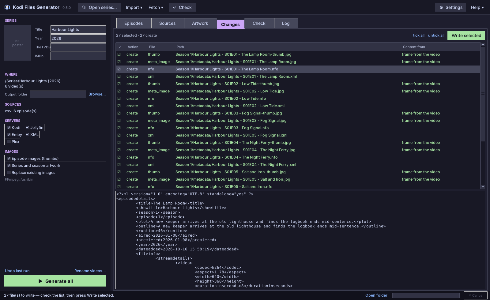
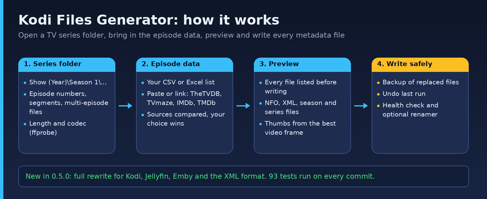

# Kodi Files Generator

**Put a TV series online fast: every NFO, XML and image Kodi, Jellyfin and Emby need, from your own episode list
or free data, without TheTVDB's paid API.**

[](LICENSE)  [](https://github.com/junqueirach/kodi-files-generator/actions/workflows/ci.yml)

<p align="center"></p>

**Download for Windows:** get `Kodi-Files-Generator-<version>-win64.zip` (about 21 MB) from the
[latest release](https://github.com/junqueirach/kodi-files-generator/releases/latest), unzip it anywhere and start
`Kodi Files Generator.exe`. No Python needed. The SHA-256 of the zip is in the release notes. FFmpeg is not included;
the app uses your own copy if you have one (see below).

> **Windows SmartScreen:** the file is not code-signed, so Windows may show "Windows protected your PC". Click **More info**, then **Run anyway**. You can also run the app from source (see Quick start) and read every line of the code first.

## How it works

<p align="center"></p>

## What it does

- **Opens a series folder** (`Show (Year)\Season 1\…`): every video is read — its episode number (`S01E01`, `1x01`,
  `S01E01E02`, `pt1`/`pt2` segments), its length and codec (ffprobe) and the files it already has.
- **Episode data from where you have it**
  - your **CSV / Excel** list — any column names (the app suggests the match, also for Portuguese headers, and
    remembers it), `;` or `,`, UTF-8 or Excel "ANSI", blank or polluted lines listed instead of silently dropped;
  - a **paste** from TheTVDB's *All Seasons → Official* page (specials keep the place where they aired);
  - a **link**: TheTVDB (any page of the series or its ID), TVmaze, IMDb or TMDb. With "read each episode page"
    TheTVDB also gives runtime, rating per country, IMDb ID, writers, directors, guest stars and the **titles and
    plots in your language**. The result can be saved as a CSV to complete in Excel.
  - **TVmaze** (free, no key) fills empty fields and adds directors, writers, guest stars, cast and images;
    **TMDb** and **OMDb** with your own free keys.
- **When databases disagree** every value keeps its source: the *Sources* tab shows them side by side, rules per
  field decide (e.g. runtime from the video file first), and your choice always wins. Episodes are matched by
  number, then by air date and title.
- **Writes** (after a preview of every file):
  - episode `.nfo` (Kodi, Jellyfin, Emby) and `metadata\<episode>.xml` (MediaBrowser / Media Center Master format) with
    cast, crew, guest stars, ratings, all IDs and the real codec / duration;
  - `tvshow.nfo`, `series.xml`, `season.nfo`;
  - **episode images** `<episode>-thumb.jpg` and `metadata\<episode>.jpg` — from an existing image, the databases or the
    **best frame of the video** (black, white and flat frames skipped, black bars cut);
  - series and season artwork (poster, folder, fanart, backdrop, banner, logo, clear art, season posters).
- **Safe**: replaced files are backed up in `.kfg_backup`, **Undo last run**, every written file is checked to be
  valid XML; a health check lists missing videos, numbering gaps and conflicts. The optional renamer moves subtitles,
  NFO, images and metadata with each video.

## Files per server

| | Kodi | Jellyfin | Emby | XML format | Plex |
|---|---|---|---|---|---|
| Episode text | `<episode>.nfo` | `<episode>.nfo` | `<episode>.nfo` | `metadata\<episode>.xml` | — |
| Episode image | `<episode>-thumb.jpg` | `-thumb.jpg` or `metadata\<episode>.jpg` | `-thumb.jpg` | `metadata\<image>.jpg` (named in the XML) | `<episode>.jpg` |
| Series | `tvshow.nfo` | `tvshow.nfo` | `tvshow.nfo` | `series.xml` | — |
| Season | — | `season.nfo` | `season.nfo` | — | — |

## Quick start (from source)

```
pip install -r requirements.txt
python kodi_generator.py          (or double-click "Kodi Generator.bat")
```

1. **📂 Open series…** — the show folder.
2. **Import ▾** (CSV / Excel, Paste, New CSV from a link) and/or **Fetch ▾** (TVmaze, TheTVDB, TMDb, OMDb).
3. Check the **Episodes** and **Sources** tabs.
4. **▶ Generate all** → the **Changes** tab lists every file → **Write selected**.

FFmpeg (optional, for video frames and technical info) is found on `PATH`, in `C:\FFmpeg\bin` or through
Settings → Files. Settings are saved in `~/.kodi_files_generator.json`, outside this folder; TMDb and OMDb keys you
enter stay on your computer.

## Development

```
pip install -r requirements.txt pytest
python -m pytest tests -q
python tools/make_icon.py
python tools/gui_harness.py <app.py> <work> <shots> [<read-only series>]   # drives the real window (Windows)
```

The code: `kfg_core.py` (data model, imports, names, matching), `kfg_writers.py` (NFO / XML), `kfg_sources.py`
(TheTVDB pages, TVmaze, TMDb, OMDb), `kfg_media.py` (FFmpeg, images), `kfg_engine.py` (plan, write, backup, undo,
health, renamer) — none of them uses Tk — and `kodi_generator.py` (the window). Tests need no network and no
real media (tiny test videos are made by FFmpeg). Six parser tests read saved TheTVDB pages from `tests/fixtures/`;
those copies of third-party pages are not published here, so the tests are skipped on GitHub (93 run in CI). The GUI
harness needs them too.

## How this was built

Built with **Claude (Anthropic)** as the coding partner. I wrote the requirements and the revision prompts, tested
every build on real data, and decided what to fix next. Version 0.5.0 is a full rewrite of the single-file R4: about
5,700 lines in six modules, 6 versions so far. The `archive/versions/` folder keeps every earlier version (R0–R4) so
the iteration history is visible.

## Contributing and security

See [CONTRIBUTING.md](CONTRIBUTING.md) and [SECURITY.md](SECURITY.md). Bug reports and ideas are welcome through the issue templates.

## Credits and licence

Data credits: [TVmaze](https://www.tvmaze.com) (CC BY-SA 4.0); TheTVDB website for personal use; TMDb and OMDb
with your own keys. This product uses the TMDb API but is not endorsed or certified by TMDb.

MIT. See [LICENSE](LICENSE).

## Author

Luiz Junqueira - [junqueira.ch](https://www.junqueira.ch) - [LinkedIn](https://www.linkedin.com/in/luizjunqueira/) - junqueira.ch@gmail.com
